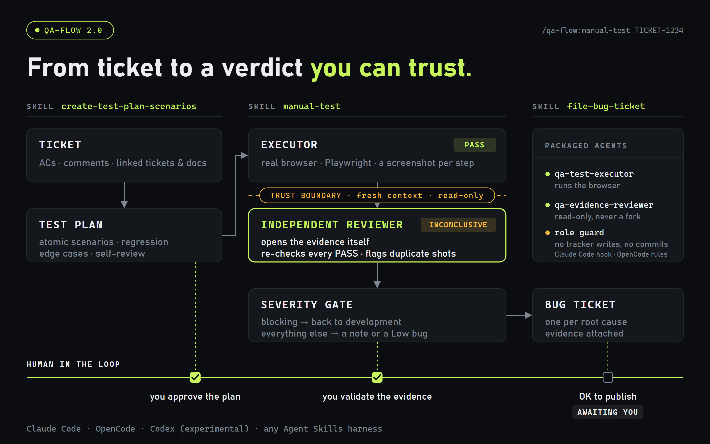

<h1 align="center">claude-qa-flow</h1>

<p align="center">
  <strong>From ticket to a verdict you can trust.</strong><br>
  A QA workflow for AI coding agents: a reviewed test plan, a real-browser run, an independent evidence review, and evidence-backed bug tickets.
</p>

<p align="center">
  <a href="https://github.com/QAMarcos/claude-qa-flow/actions/workflows/check.yml"></a>
  <a href="CHANGELOG.md"></a>
  <a href="LICENSE"></a>
  <a href="https://agentskills.io"></a>
  <a href="#claude-code--plugin-recommended"></a>
  <a href="#opencode"></a>
</p>

<p align="center">
  <a href="#installation">Install</a> ·
  <a href="#usage">Usage</a> ·
  <a href="#why-it-works">How it works</a> ·
  <a href="#customizing-the-roles">Customize</a> ·
  <a href="CHANGELOG.md">Changelog</a>
</p>

<p align="center">
  
</p>

- **Harness-agnostic** — built on the open [Agent Skills](https://agentskills.io) format. Tested in [Claude Code](https://claude.com/claude-code) and [OpenCode](https://opencode.ai); ships an experimental (untested) adapter for OpenAI Codex; the skills run in any harness that reads `SKILL.md`.
- **Model-agnostic** — the skills speak in capability tiers (`fast` / `balanced` / `deep`), not vendor model names. Map them to whatever your provider offers.
- **Tracker-agnostic** — Jira, Linear, GitHub Issues, Shortcut, … via their REST APIs.
- **Driven by [Playwright](https://playwright.dev/)** for execution, reusing your existing e2e project.

---

## The flow

1. **`create-test-plan-scenarios`** reads a ticket (description, ACs, comments, linked docs) and produces atomic, observable scenarios — including regression, edge cases and cross-surface side effects. It self-reviews the list and shows it to you before posting it back as sub-tasks.
2. **You review the plan.** The model can misread an ambiguous spec and then test it the way it understood it. This is where you catch that.
3. **`manual-test`** resolves context with you (environment, scope, known bugs, what has no backend yet), then hands a six-section brief to an **executor** that drives a headed browser through a throwaway Playwright script and captures evidence. An **independent reviewer** — fresh context, read-only — opens the screenshots itself, overturns fragile `PASS` verdicts, and classifies every finding with a **severity gate** whose default is *don't block the feature*.
4. **`file-bug-ticket`** files one bug per root cause, inside a character budget, with the screenshots attached and everything verified by a GET — only after the review and your approval.

Each skill also runs on its own.

## Why it works

- **Roles, not one long prompt.** The executor, the reviewer and the tracker writer are separate roles with separate permissions. The reviewer never sees the executor's reasoning — only its claims and the evidence on disk — so it catches what the executor was anchored on.
- **Permissions backed by the harness, not just requested.** Where the harness supports it, the packaged agents are blocked from the common ways of breaking their role: the reviewer runs only read-only commands, and neither role can post to the tracker or commit (a Claude Code hook, or OpenCode's native `permission` rules). This is a **best-effort guard on the command line** — code that does its own HTTP (a `node -e "fetch(…)"`, a request inside the Playwright spec) is not caught — and neither are every shell wrapper or tracker CLI beyond `gh` / `glab` / `jira` — so the role instructions stay the primary control and the human gate before every external write stays mandatory.
- **Evidence discipline.** A `PASS` must cite a screenshot that shows the claimed state; duplicate screenshots (same hash) expose interactions that never happened; a timed-out click is `INCONCLUSIVE`, never "after".
- **Honest statuses.** `BLOCKED-BY-DEPENDENCY`, `PO-DECISION` and `INCONCLUSIVE` keep "the backend isn't there yet" and "the AC is ambiguous" from being reported as failures.
- **Human in the loop for external writes.** Bug tickets and result comments from a QA run are posted only after the reviewer and your explicit OK; a test plan is posted after you approve the list (or automatically, if you explicitly enable auto mode for the session).
- **Throwaway, not tracked.** Scripts, evidence and logs live in a git-ignored `_local/` folder and are never committed — and never auto-deleted while you may still want to re-run them.

## What's inside

| Component | What it is | Portable? |
|---|---|---|
| `skills/create-test-plan-scenarios` | Ticket → reviewed QA checklist | Any Agent Skills harness |
| `skills/manual-test` | Orchestrates executor → reviewer → report → filing | Any Agent Skills harness |
| `skills/file-bug-ticket` | Terse, budgeted bug tickets with evidence | Any Agent Skills harness |
| `skills/manual-test/roles/*.md` | **Single source** of the executor and reviewer roles | Read directly by a generic subagent |
| `agents/` | Claude Code subagents (generated) | Claude Code |
| `adapters/opencode/agents/` | OpenCode subagents with `permission` rules (generated) | OpenCode |
| `adapters/codex/agents/` | Codex custom agents, TOML (generated) | Codex |
| `hooks/` + `scripts/guard-tracker-writes.mjs` | Blocks tracker writes / non-read commands for the two roles | Claude Code |

### How each harness runs it

| Harness | Skills | Executor / reviewer | Role boundaries enforced by |
|---|---|---|---|
| Claude Code (plugin) — tested | ✅ | ✅ packaged subagents | `tools:` allowlist + PreToolUse hook (best effort) |
| OpenCode — tested | ✅ | ✅ packaged subagents | native `permission` rules (best effort) |
| Codex — experimental, untested | ✅ | ✅ custom agents | instructions only (subagents inherit the parent sandbox) |
| Any other Agent Skills harness | ✅ | generic subagent reading `roles/*.md` | instructions only |
| No subagents at all | ✅ | roles played sequentially; review flagged as *not independent* | instructions only |

### Model tiers

The skills choose a tier per run — e.g. a one-assertion check gets `balanced`, a 6-scenario run with network correlation gets `deep+`, and the reviewer is always `deep`.

| Tier | Meaning | Claude | Other providers (examples) |
|---|---|---|---|
| `fast` | Mechanical, deterministic | Haiku | GPT mini-class, Gemini Flash-class |
| `balanced` | Follows a playbook well | Sonnet | GPT standard, Gemini Pro-class |
| `deep` | Judgement, open-ended reasoning, long runs | Opus | top reasoning tier of your provider |
| `deep+` | `deep` at the highest reasoning effort | Opus, max effort | top tier, highest effort |

**Plan with a stronger model, execute with a cheaper one** where the plan is simple — the skills already encode that.

## Requirements

- An AI coding harness that reads Agent Skills (see the table above).
- A Playwright e2e project to run `manual-test` from (Node.js + `@playwright/test`).
- Node.js ≥ 18 for the install/build scripts (no dependencies).
- A **vision-capable model** for the executor and reviewer — they must open the screenshots to judge the evidence.
- An issue tracker with a REST API for the fetch / post-back steps (optional — every skill also works from text you paste in).

## Installation

### Claude Code — plugin (recommended)

```
/plugin marketplace add QAMarcos/claude-qa-flow
/plugin install qa-flow@qa-flow
```


Skills, subagents and the guard hook are set up automatically. Skills appear namespaced: `/qa-flow:manual-test`.

### OpenCode

```bash
git clone https://github.com/QAMarcos/claude-qa-flow.git
cd claude-qa-flow
node scripts/install.mjs --target opencode
```

Copies the skills to `~/.config/opencode/skills/` and the subagents (with their `permission` rules) to `~/.config/opencode/agents/`. Use `--scope project` to install into the current project's `.opencode/` instead. Optionally pin a `deep`-tier model in the reviewer's `model:` line.

### Codex

```bash
node scripts/install.mjs --target codex
```

Skills → `~/.agents/skills/`, custom agents → `~/.codex/agents/`.

### Any other Agent Skills harness

```bash
node scripts/install.mjs --target agents
```

Copies the skills to `~/.agents/skills/` (the cross-harness location). If your harness uses another folder, copy `skills/*` there — each skill is self-contained, roles included.

### Claude Code without the plugin

```bash
node scripts/install.mjs --target claude
```

Copies skills and subagents into `~/.claude/` and prints the `settings.json` snippet to enable the guard hook (the script never edits your settings).

All install targets skip folders that already exist unless you pass `--force`, and support `--dry-run`. `--force` overwrites files but does not delete files removed upstream.

### Upgrading from 1.x

1.x was installed by copying `create-test-plan-scenarios/` and `manual-test/` into `~/.claude/skills/` (or a project's `.claude/skills/`). Remove those two folders before installing 2.x — otherwise the installer skips them (old content stays), and with the plugin you get both `manual-test` and `qa-flow:manual-test`. OpenCode also reads `~/.claude/skills/`, so stale 1.x copies show up there too.

## Configuration

Each `SKILL.md` has a **Configuration** section with placeholders. Nothing is hard-coded to a company.

| Placeholder | What it is |
|---|---|
| `TRACKER_API_BASE` | Base URL of your tracker's REST API. |
| `TRACKER_TOKEN` | API token — **in env or a git-ignored `.env.local`, never in a skill file, never in git.** |
| `TRACKER_STORY_URL` | Human-facing URL pattern for a ticket. |
| App URLs | Staging / production (staging is the default; prod needs an explicit instruction). |
| Auth fixtures | Your stored `storageState`, e.g. `playwright/.auth/user.json`. |
| Scratch root | A **git-ignored** folder for throwaway work (default `_local/`). |
| Owners / workspace ids | For `file-bug-ticket`: who owns front-end vs back-end bugs, default project, states. |

**Local hosts.** The Claude Code hook lets the executor send mutating requests to `localhost`, `127.0.0.1` and `*.test` / `*.localhost` (e.g. seeding a local app); the OpenCode rules deny every mutating `curl`, local or not — they are glob patterns checked per command and do not look at hosts, so they are also coarser than the hook in general.

Behind bot protection / a WAF? The throwaway Playwright config has a spot for the `userAgent`/header your infra requires — sourced from env, never hard-coded.

> **Security:** never commit tokens or credentials. Keep them in a git-ignored `.env.local` and let the skills read them at runtime.

## Usage

Invoke by name, or just describe the task — each skill lists its trigger phrases.

```
/create-test-plan-scenarios TICKET-1234
/manual-test TICKET-1234
/manual-test Log in as a free-tier user, open Billing, and verify the "Upgrade" CTA is visible.
/file-bug-ticket The export button overlaps the table header at 1280px — screenshot in _local/evidence/export/
```

(Claude Code plugin: prefix with `qa-flow:`. OpenCode / Codex: invoke the skill by name or describe the task.)

## Getting the best results

- **Review the plan before executing.** It is the cheapest place to catch a misread spec.
- **Tell `manual-test` what has no backend or data yet.** Those ACs become `BLOCKED-BY-DEPENDENCY` instead of false failures.
- **Let the reviewer run.** It is the step that most often changes the verdict — overturning a `PASS` backed by the wrong screenshot, or stopping a "bug" that is the product working as designed.
- **Respect the severity gate.** Rare triggers, fault-injection-only findings and "reload fixes it" become Low notes, not blockers. Promoting to blocking is your call.
- **Review the results too** before you post them or open a bug.
- **Promote proven flows to real specs.** When a throwaway scenario keeps getting re-run, migrate it into your committed suite following your project's patterns.

## Customizing the roles

The executor and reviewer are defined once, in `skills/manual-test/roles/`. The harness-specific agent files are generated from them:

```bash
node scripts/build-agents.mjs          # regenerate agents/ and adapters/
node scripts/build-agents.mjs --check  # CI: fail if generated files are stale
```

Edit the role (or a file in `skills/manual-test/references/` that a role includes), rebuild, commit both.

## Repository layout

```
claude-qa-flow/
├─ .claude-plugin/           plugin.json + marketplace.json (Claude Code)
├─ skills/
│  ├─ create-test-plan-scenarios/SKILL.md
│  ├─ manual-test/
│  │  ├─ SKILL.md
│  │  ├─ roles/              test-executor.md · evidence-reviewer.md   (single source)
│  │  └─ references/         evidence discipline · severity gate · report format ·
│  │                         Playwright templates · filing & comments
│  └─ file-bug-ticket/SKILL.md
├─ agents/                   Claude Code subagents        (generated)
├─ adapters/
│  ├─ opencode/agents/       OpenCode subagents           (generated)
│  └─ codex/agents/          Codex custom agents          (generated)
├─ hooks/hooks.json          Claude Code guard hook
├─ scripts/                  build-agents · guard-tracker-writes · test-guard · install
├─ .github/                  CI (generated files, guard regression cases, skill names) · PR template
├─ docs/assets/              README diagram and social preview (SVG source + rendered PNG)
├─ CONTRIBUTING.md
├─ CHANGELOG.md
├─ README.md
└─ LICENSE
```

## License

MIT — see [LICENSE](./LICENSE).
